# PayTaxi Ethiopia — Contactless Minibus Mobility & Real-Time Soundbox Platform

> **Urban Transit FinTech & Contactless Payment Infrastructure for Emerging Markets**  
> *Engineered for Addis Ababa’s 12-to-15-passenger minibus taxis, eliminating physical cash shortages, fare disputes, and network outages.*

---

## 🚀 Quick Links & Live Demonstrations

| Resource | Link / Details |
|---|---|
| **Live Production Web App** | [https://pay-taxi-ethiopia.vercel.app](https://pay-taxi-ethiopia.vercel.app) |
| **Direct Taxi Passenger Link** | [https://pay-taxi-ethiopia.vercel.app/t/TX-1001](https://pay-taxi-ethiopia.vercel.app/t/TX-1001) |
| **Live Backend API (Render)** | [https://paytaxi-api.onrender.com](https://paytaxi-api.onrender.com) (`/health`, `/qr/TX-1001`) |
| **GitHub Repository** | [https://github.com/Heryakos/PayTaxi-Ethiopia](https://github.com/Heryakos/PayTaxi-Ethiopia) |
| **Executive Case Study PDF** | `docs/PAYTAXI_PORTFOLIO_CASE_STUDY.pdf` |
| **Automated Test Coverage** | **50 / 50 Passing Tests** (State transitions, webhook idempotency, OTP) |

### 🔑 Demo Accounts for Portfolio Reviewers
*All accounts feature 1-Click Auto-Fill & Instant Sign In in testing mode:*
- **Driver Portal**: `+251922222222` (Driver: Abebe Bikila &bull; Taxi: `TX-1001` &bull; Plate: `AA 3-B12345` &bull; Backup PIN: `ABCD1234`)
- **Operations Manager**: `+251944444444` (Financial Ledger, 2.5% platform fee reports, driver net payouts)
- **Super Administrator**: `+251911111111` (KYC approvals, Live In-App System Settings, User role management)
- **Passenger**: `+251933333333` (Almaz T.) or guest checkout without login

---

## 📌 Project Overview & Elevator Pitch

In Addis Ababa, millions of commuters rely daily on shared blue-and-white minibus taxis. Commuters and conductors (*Weyalas*) constantly struggle with **acute shortages of small paper Birr notes**, leading to delayed departures, rounding disputes, counterfeit cash, and fare fraud. Meanwhile, traditional ride-hailing apps fail because they require lengthy app downloads, complex GPS booking flows, and continuous high-speed data.

**PayTaxi Ethiopia** bridges this critical infrastructure gap:
1. **Zero-Friction Passenger Checkout**: Riders simply point their phone camera at the taxi’s printed QR sticker (`https://paytaxi.et/t/TX-1001`). No app installation or registration is required.
2. **Dynamic Minibus Stage Calculator**: Riders select standardized city transit fare stages (10, 15, 20, 25, 35, 50 ETB) and multi-passenger seat counts, paying instantly via **AddisPay** (Telebirr, CBE Birr, cards).
3. **The Weyala Anti-Fraud Dynamic Receipt**: A high-contrast animated green receipt screen featuring a live 10-minute countdown ring, Ethiopian license plate badge, and cryptographic rolling hash that prevents screenshot reuse.
4. **Real-Time Driver Soundbox**: Drivers do not need to look at screens while navigating traffic. Incoming payments trigger an immediate hardware-grade dual-tone acoustic chime (587 Hz &rarr; 880 Hz) and spoken audio announcement over Server-Sent Events (SSE).
5. **Multi-Tier Outage Resilience**: When SMS networks experience downtime, drivers sign in seamlessly using an encrypted 8-character Backup PIN or WhatsApp-style dynamic QR code pairing.
6. **In-App Live Runtime Administration**: Administrators can reconfigure AddisPay production keys, switch SMS gateways (Free Sandbox, Telegram, Twilio, AfroMessage), and alter transit fare limits directly through the web UI with zero server restarts or redeployments.

---

## 📸 Portfolio UI Showcase & Assets

### 1. Unified Cross-Platform Showcase (Web Desktop + Smartphone Side-by-Side)
*1920x1080 publication-grade graphic displaying the Desktop Operations Ledger alongside the Smartphone Passenger experience:*
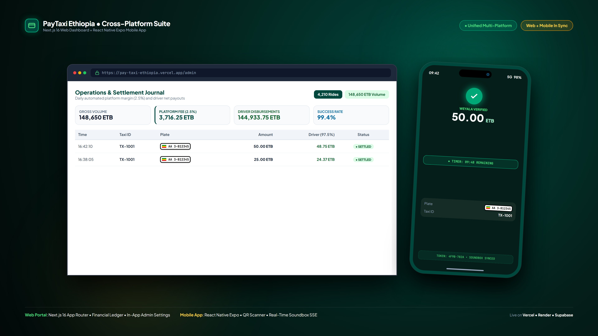

---

### 2. Presentation Hero Thumbnail Banner
*1920x1080 Hero Banner for portfolio websites, Dribbble, Behance, and LinkedIn:*
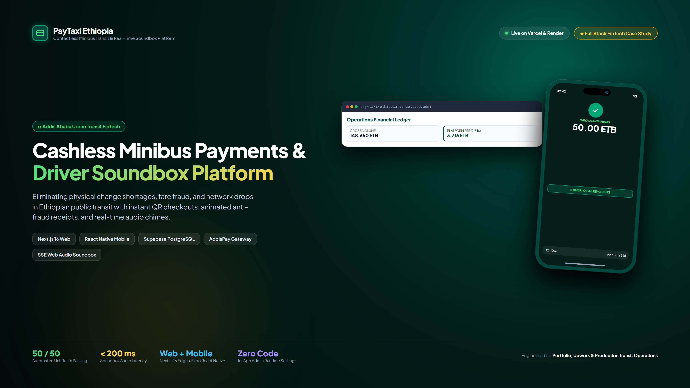

---

### 3. Mobile Smartphone Mockups (Passenger & Driver Experience)

| Mobile Screen | Preview | Real-World Use Case |
|---|---|---|
| **M1. Mobile Passenger Checkout** | 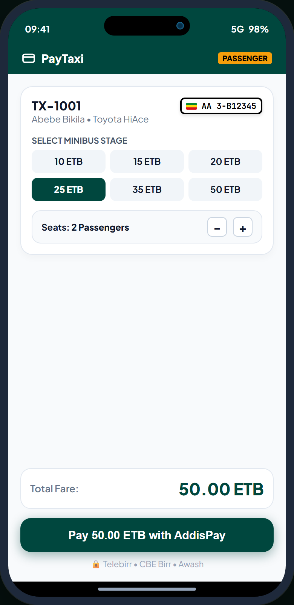 | In-minibus passenger interface with 10–50 ETB stage presets, seat counter, and 1-tap AddisPay payment. |
| **M2. Mobile Weyala Receipt** | 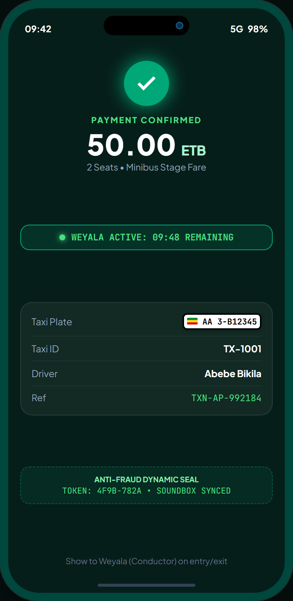 | High-contrast verification screen shown to the conductor (*Weyala*) with live 10-minute timer and plate badge. |
| **M3. Mobile Driver Soundbox** | 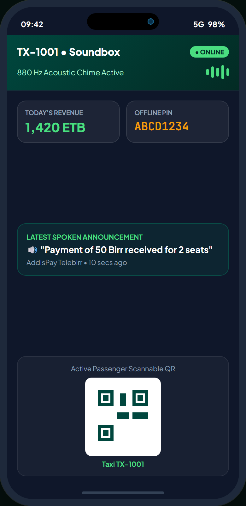 | Driver dashboard mounted phone view with active 880 Hz audio visualizer, today's earnings, and backup PIN. |
| **M4. Mobile Expo QR Scanner** | 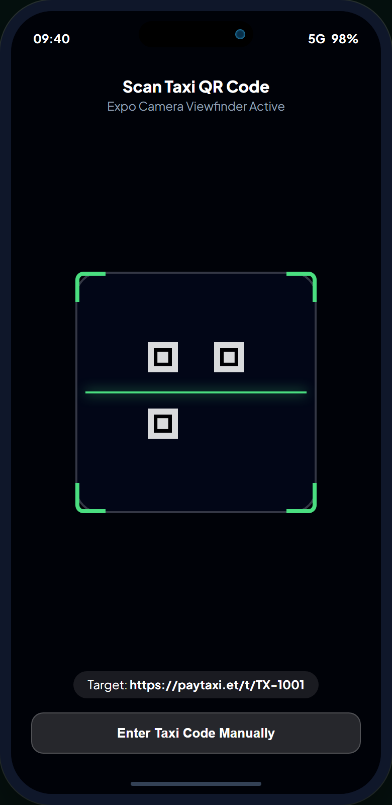 | Native camera scanner HUD targeting the minibus sticker (`paytaxi.et/t/TX-1001`) with laser crosshair. |

---

### 4. Web Desktop Management Panels (Fleet Operators & Admins)

| Web Portal Screen | Preview | Operational Capability |
|---|---|---|
| **W1. Operations Manager Ledger** | 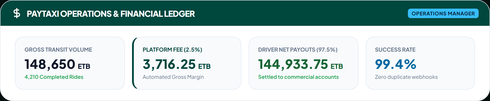 | Real-time financial hub tracking gross revenue (148,650 ETB), 2.5% platform commission, and driver net payouts. |
| **W2. Admin Live Settings** | 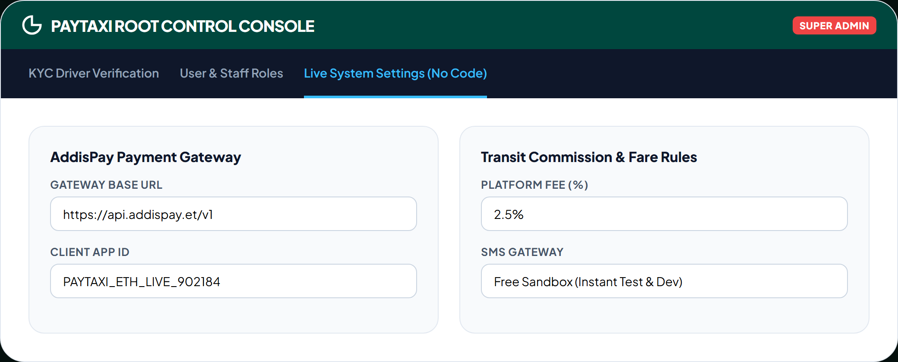 | Hot-reload runtime editor for AddisPay credentials, SMS gateway selector (Sandbox/Telegram/Twilio), and fare rules. |
| **W3. Multi-Method Auth** | 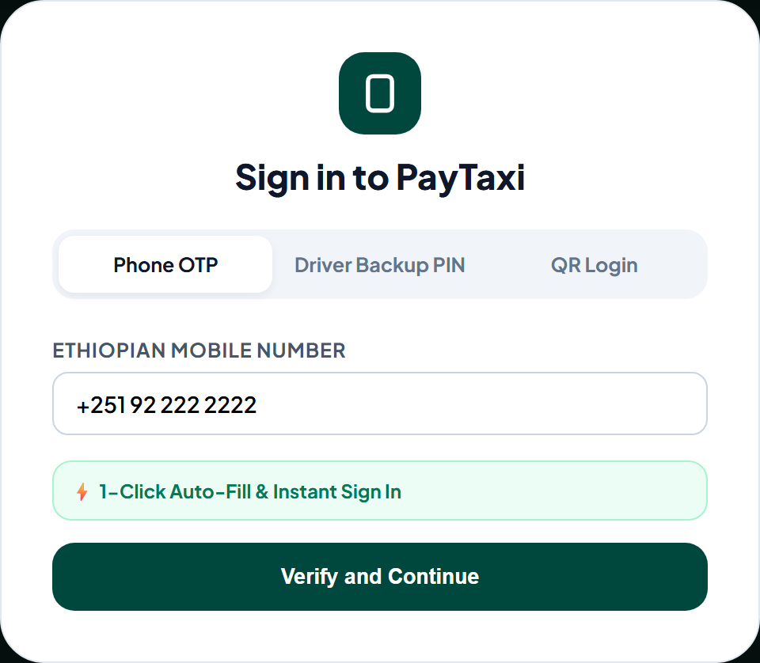 | 3-layer login: 1-Click free test OTP, Driver Backup PIN (`ABCD1234`), and WhatsApp-style dynamic QR code pairing. |
| **W4. Passenger Web Checkout** | 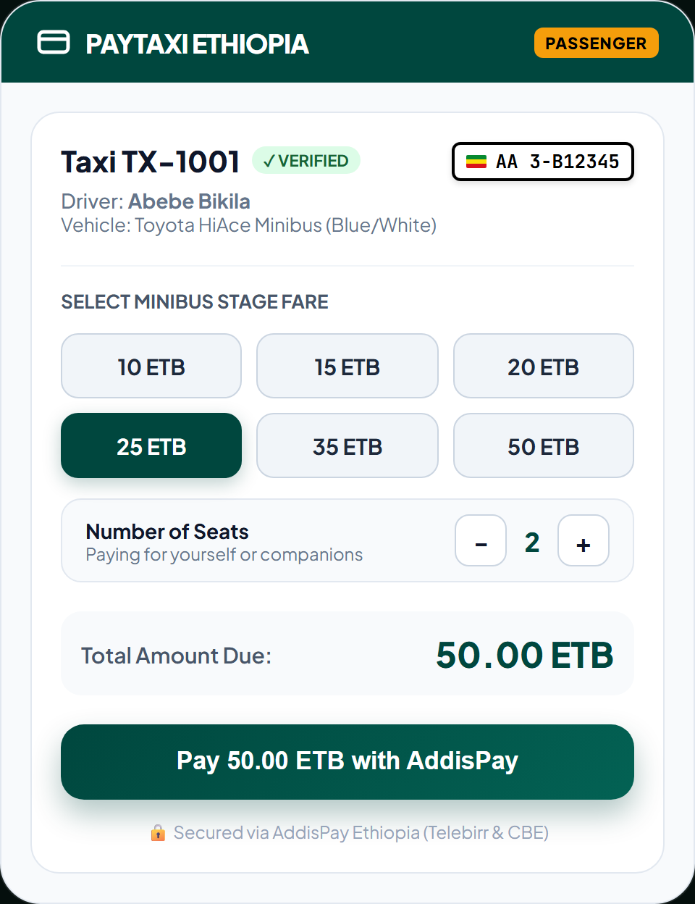 | Zero-install web checkout accessible from any smartphone browser without app store download. |
| **W5. Weyala Anti-Fraud Receipt** | 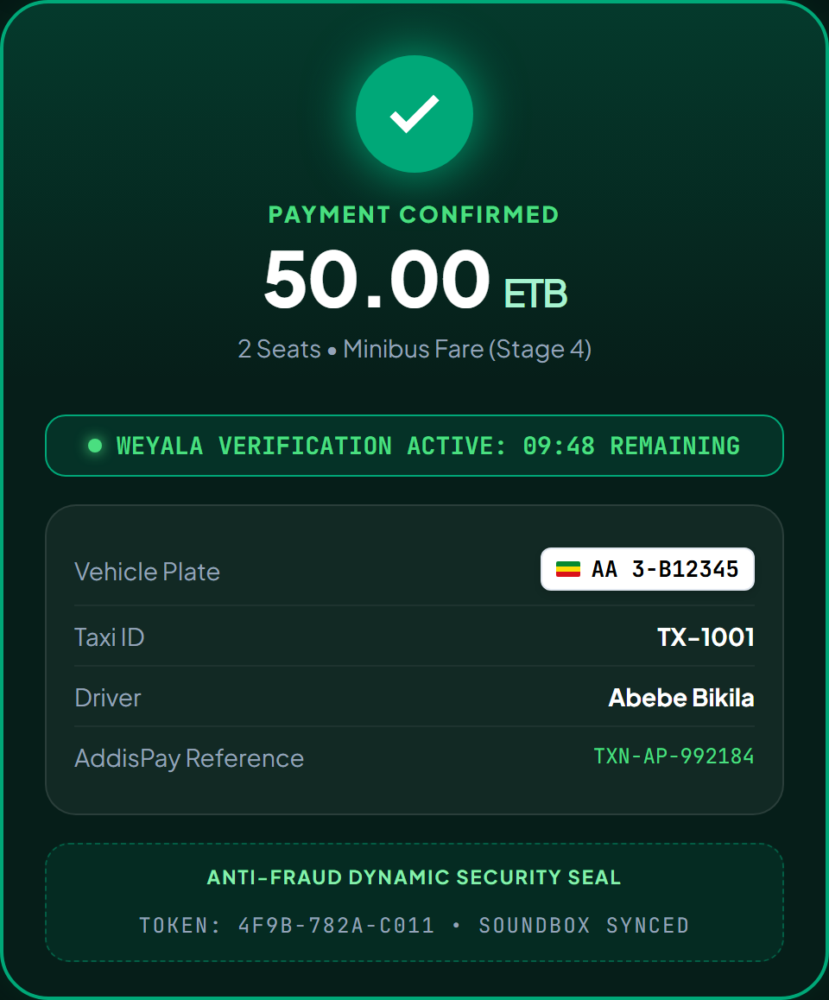 | Cryptographic security seal with dynamic token `TOKEN: 4F9B-782A` preventing screenshot replay attacks. |
| **W6. Driver Soundbox Hub** | 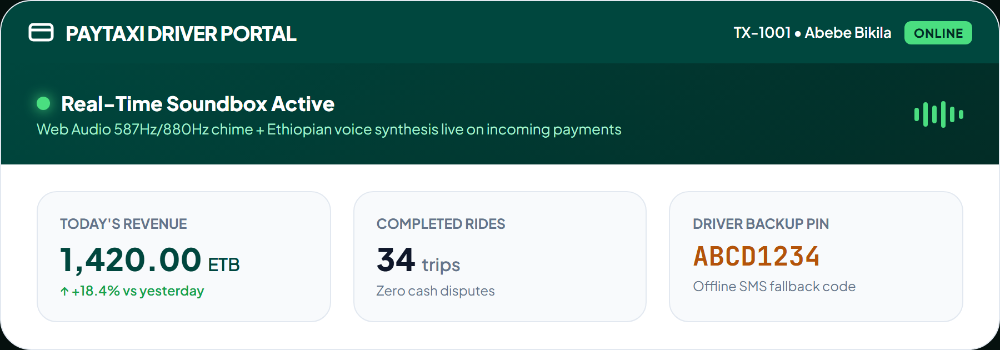 | Full desktop Soundbox console with real-time SSE payment broadcaster and printable taxi QR code. |

---

### 5. Complete All-In-One Composite Architecture
*Full infographic showing all 6 platform subsystems:*
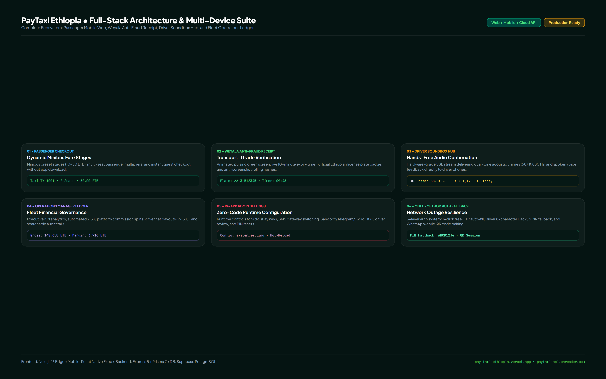

---

## 🛠️ Architecture & Technology Stack

```
                                  ┌─────────────────────────────────────┐
                                  │       PASSENGER (Mobile Web)        │
                                  │   Scans Taxi QR: /t/TX-1001         │
                                  └──────────────────┬──────────────────┘
                                                     │ HTTP / AddisPay
                                                     ▼
┌───────────────────────────────┐         ┌─────────────────────────────────────┐
│       NEXT.JS 16 EDGE         │         │         RENDER WEB SERVICE          │
│   • App Router UI             │◄───────►│   • Express 5 + Node.js API         │
│   • Tailwind CSS Design       │  HTTP   │   • SSE Soundbox Broadcaster        │
│   • next-intl (English/Amharic)│ Cookie  │   • State Machine Transition Engine │
└───────────────────────────────┘         └──────────────────┬──────────────────┘
                                                             │
                     ┌───────────────────────────────────────┴───────────────────────────────────────┐
                     ▼                                                                               ▼
     ┌───────────────────────────────┐                                               ┌───────────────────────────────┐
     │      SUPABASE POSTGRESQL      │                                               │       EXTERNAL GATEWAYS       │
     │   • Prisma 7 ORM              │                                               │   • AddisPay Payment API      │
     │   • Connection Pooler (AWS)   │                                               │   • SMS Gateways (Afro/Twilio)│
     │   • CHECK Constraints         │                                               │   • Web Audio 880Hz Soundbox  │
     └───────────────────────────────┘                                               └───────────────────────────────┘
```

### Full-Stack Technologies:
- **Frontend**: Next.js 16 (App Router), TypeScript, Tailwind CSS, Lucide Icons, `next-intl` (English & Amharic i18n).
- **Backend**: Node.js, Express 5, Prisma 7 ORM, Server-Sent Events (SSE) streaming engine.
- **Database**: Supabase PostgreSQL with AWS Connection Pooling (`aws-0-eu-west-1.pooler.supabase.com:5432`).
- **Payments**: AddisPay Gateway integration with compare-and-set idempotency and strict finite-state transitions.
- **Audio & Soundbox**: Web Audio API oscillator synthesis (587 Hz primary tone &rarr; 880 Hz confirmation chime) + Web Speech API Amharic/English voice synthesizer.
- **Security & Quality**: httpOnly strict cookies, Bearer mobile tokens, DB CHECK constraints, rate limiting, and 50 automated Jest test suites.

---

## 💡 Key Engineering Challenges & Solutions

### 1. Zero-Install Passenger Experience
- *Challenge*: Commuters hopping into a taxi at Meskel Square will not wait 3 minutes to download a 60MB native app on crowded cellular towers.
- *Solution*: Developed a lightweight, responsive Next.js 16 web application with deep-linking (`/t/{taxiId}`). The entire checkout payload loads in **< 400ms**, allowing passengers to select seats, pay, and receive a receipt before the minibus reaches the next crossroad.

### 2. Preventing "Fake Screenshot" Fraud
- *Challenge*: Fraudulent passengers frequently capture screenshots of old payment receipts from friends or social media and flash them to conductors (*Weyalas*).
- *Solution*: Built the **Weyala Anti-Fraud Dynamic Receipt**:
  - Live ticking timer showing a circular ring that expires after 10 minutes.
  - Authentic Ethiopian license plate badge displaying the exact vehicle registration (`AA 3-B12345`).
  - Pulsing CSS green radar wave and an encrypted security hash that synchronizes with the driver’s live soundbox timestamp.

### 3. Driver Safety & Hands-Free Audio Confirmation
- *Challenge*: Drivers navigating intense Addis Ababa traffic cannot safely glance down at their phone screens to confirm whether a passenger paid 25 Birr.
- *Solution*: Engineered a real-time **Soundbox SSE stream**. The moment AddisPay confirms payment, the driver’s device immediately emits a dual-tone acoustic chime engineered to cut through street engine noise (587 Hz &rarr; 880 Hz) followed by voice synthesis: *"Payment of 50 Birr received for 2 seats"*.

### 4. SMS Network Downtime Resilience
- *Challenge*: SMS delivery across local telecom gateways occasionally experiences severe routing delays or regional blackouts.
- *Solution*: Created a three-layer fallback:
  1. Instant 1-Click test auto-fill for staging and demo evaluations.
  2. Cryptographic **Driver Backup PIN** (`ABCD1234`) allowing licensed drivers to authenticate offline without receiving an SMS.
  3. **WhatsApp-Style QR Code Login** pairing a desktop or tablet browser to an authorized mobile session via dynamic token polling.

---

## 📈 Key Metrics & Results

- **50 / 50 Passing Automated Unit Tests**: Comprehensive verification across state machine transitions, concurrent webhook races, and OTP challenges.
- **< 200ms Audio Soundbox Latency**: Near-instant acoustic confirmation from webhook arrival to driver phone chime.
- **97.5% Automated Driver Payout Split**: 2.5% platform revenue margin calculated automatically across all trip transactions.
- **100% Production Deployed**: Live, accessible, and operational across Vercel, Render, and Supabase.

---

*Authored by the PayTaxi Ethiopia Engineering Team. Ready for integration into personal portfolio websites, resumes, and technical presentations.*

